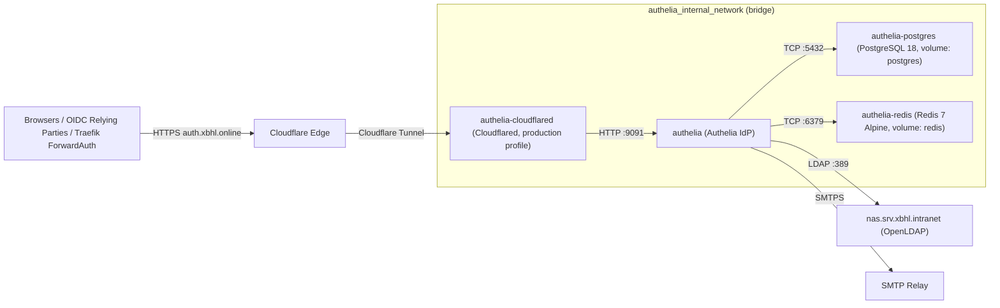

# Authelia

> Version: `4.39.28` | Images: `ghcr.io/authelia/authelia:4.39.28`, `docker.io/library/postgres:18.4`, `docker.io/library/redis:7.2-alpine`, `cloudflare/cloudflared:2026.7.3` | Upstream: https://github.com/authelia/authelia

Central OpenID Connect (OIDC) 1.0 Identity Provider, WebAuthn/passkey two-factor authentication portal, and forward-auth policy engine for `xbhl.online` and `intranet.xbhl.online` services.

## Service Overview

| Property | Value |
| :--- | :--- |
| **Domain** | `https://auth.xbhl.online` |
| **Primary Node** | `nas.srv.xbhl.intranet` (QNAP NAS Docker Host) |
| **Deploy Path** | `/share/Container/services/authelia` |
| **Ingress Strategy** | Cloudflare Tunnel (`cloudflare-dns-strategy: tunnel`, UUID `6e38abb8-22c1-48b0-a19c-9da7ea15a3a0`) |
| **Topology Archetype** | Central Identity Provider (`authelia` + PostgreSQL + Redis + Cloudflared) |
| **Authentication** | Custom LDAP directory (`ldap://nas.srv.xbhl.intranet`) + WebAuthn / Passkey 2FA (`two_factor` on `*.xbhl.online`) |
| **Ecosystem** | WUD SemVer tracking on `authelia`; Gatus health & container checks (`authelia` group on `https://status.intranet.xbhl.online`); not listed as a tile on Homepage (`https://start.intranet.xbhl.online`, which authenticates via Authelia OIDC) |

## Architecture & Communication

- **Isolated Tunnel Runtime**: All four containers join `authelia_internal_network` with zero published host ports and zero Traefik labels. `authelia-cloudflared` runs under `profiles: ["production"]` (skipped during DinD CI tests) and routes `auth.xbhl.online` to `http://authelia:9091` using `credentials.json` generated in CI by `scripts/generate-cloudflare-tunnel-credentials.sh`.
- **State & Pre-Deploy Validation**: Persistent state resides in host-local named volumes `postgres` (`/var/lib/postgresql`) and `redis` (`/data`). Before deployment, CI job `test:authelia:validate-config` renders templates (`X_AUTHELIA_CONFIG_FILTERS=template`) and runs `authelia config validate --config src/authelia-config/`. `scripts/generate-secrets.sh` is a local operator helper for generating 64-character secrets and Argon2id hashes.

### Split Configuration (`src/authelia-config/*.yaml`) & Registered OIDC Clients

Authelia loads all **11** YAML files from `/config/` (`./authelia-config:/config`) with the Go `template` filter (`{{ env "..." }}` and `{{ secret "..." }}`):

| Config File(s) | Responsibility |
| :--- | :--- |
| `server.yaml`, `logs.yaml` | Listens on `tcp://0.0.0.0:9091` (`buffers.read: 4096`, `/api/health` enabled) with `info` stdout logging. |
| `ldap.yaml` | `custom` LDAP backend targeting `ldap://nas.srv.xbhl.intranet` (`dc=ldap,dc=intranet,dc=xbhl,dc=online`, `ou=people`, `ou=group`). |
| `access_control.yaml` | `default_policy: "deny"`; rule `*.xbhl.online` enforces `two_factor`. |
| `session.yaml` | `authelia_session` cookie on domain `xbhl.online` (`authelia_url: https://auth.xbhl.online`), stored in `redis:6379`. |
| `storage.yaml` | PostgreSQL backend at `tcp://postgresql:5432` (`schema: public`) using `STORAGE_PASSWORD` and `STORAGE_ENCRYPTION_KEY`. |
| `webauthn.yaml` | WebAuthn / passkeys (`display_name: XBHL.online`, `enable_passkey_login: true`, `experimental_enable_passkey_uv_two_factors: true`). |
| `notifier.yaml`, `identity_validation.yaml` | SMTPS notifications (`submissions://`, startup check enabled) and password-reset JWT validation (`JWT_SECRET`). |
| `identity_providers.yaml` | OIDC HMAC secret (`OIDC_HMAC_SECRET`), RSA JWKS (`OIDC_ISSUER_PRIVATE_KEY`), and CORS (`allowed_origins_from_client_redirect_uris: true` plus `https://chat.ai.intranet.xbhl.online`). |
| `clients.yaml` | Custom `ocis` token lifespan (`72h` access / `3650d` refresh), `claims_policies.grafana` (`id_token: [email, name, groups, preferred_username]`), **12** confidential clients, and **4** ownCloud Infinite Scale (`ocis`) clients. |

- **Confidential OIDC Clients (12, backed by `/run/secrets/*_OAUTH_CLIENT_SECRET`)**: Open WebUI (`mnDs7U359iJiBJLmHTkMDjIVeEoeAobQCa0NjDss`), GitLab (`ZergmgVUh8i3Ud8BfpOx2g16TLh3qsumskreLuMQ`), Proxmox VE (`fRI0uSNDxxBbYQXwhuZvnR22zmz2jN9ujy8Q9xYm`), Proxmox Backup Server (`949b259188d3984589387095e7cba1862db15f33`), Nextcloud (`nextcloud`), What's Up Docker (`wud`), Vaultwarden (`vaultwarden`), LiteLLM Proxy (`litellm`), Homepage (`homepage`), BookOrbit (`bookorbit`), Portainer (`portainer`), and Grafana (`grafana`).
- **Public / Native oCIS Clients (4)**: `ocis` (`public: true`, `https://files.xbhl.online/*`) plus Desktop, Android, and iOS native clients with upstream-mandated public credentials. To onboard a new OIDC service, follow [`.agents/skills/add-service/SKILL.md`](.agents/skills/add-service/SKILL.md).

## Required GitLab CI/CD Variables

| Scope | Variable(s) | Type / Injection Target |
| :--- | :--- | :--- |
| **Group-Inherited (`home-lab`)** | `SSH_USER`, `SSH_PRIVATE_KEY`, `CLOUDFLARE_ZONE_ID`, `CLOUDFLARE_DNS_API_TOKEN` | Deployment SSH and Cloudflare tunnel DNS CNAME inputs in `.gitlab-ci.yml`. |
| **Group-Inherited (`home-lab`)** | `LDAP_PASSWORD`, `SMTP_HOST`, `SMTP_PORT`, `SMTP_USERNAME`, `SMTP_PASSWORD`, `SMTP_FROM` | Substituted via `sed -i` into `$BUILD_ARTIFACTS_DIR/envs/ldap.env` and `envs/smtp.env` (`envs/db.env` commits non-secret `authelia` defaults). |
| **Project — Tunnel & Backing Stores** | `CLOUDFLARE_TUNNEL_TOKEN`, `REDIS_PASSWORD`, `STORAGE_PASSWORD`, `STORAGE_ENCRYPTION_KEY` | Tunnel token decoded to `cloudflared-config/credentials.json`; `REDIS_PASSWORD` injected into `envs/redis.env`; PostgreSQL & storage secrets written to `secrets/shared/`. |
| **Project — Core & OIDC Signing** | `JWT_SECRET`, `SESSION_SECRET`, `OIDC_HMAC_SECRET`, `OIDC_ISSUER_PRIVATE_KEY` (**File**) | Written to `secrets/shared/`; `OIDC_ISSUER_PRIVATE_KEY` is a GitLab **File** variable flattened into single-line `\n`-escaped PEM text via `awk` for Authelia Go template rendering. |
| **Project — OIDC Client Secrets (12)** | `OPENWEBUI_OAUTH_CLIENT_SECRET`, `NEXTCLOUD_OAUTH_CLIENT_SECRET`, `WUD_OAUTH_CLIENT_SECRET`, `GITLAB_OAUTH_CLIENT_SECRET`, `PROXMOX_OAUTH_CLIENT_SECRET`, `PBS_OAUTH_CLIENT_SECRET`, `VAULTWARDEN_OAUTH_CLIENT_SECRET`, `LITELLM_OAUTH_CLIENT_SECRET`, `HOMEPAGE_OAUTH_CLIENT_SECRET`, `BOOKORBIT_OAUTH_CLIENT_SECRET`, `PORTAINER_OAUTH_CLIENT_SECRET`, `GRAFANA_OAUTH_CLIENT_SECRET` | Shared Category A secrets written to `$BUILD_ARTIFACTS_DIR/secrets/services/*` (`GITLAB_*`, `PROXMOX_*`, and `PBS_*` are materialized solely in CI without tracked `src/secrets/services/` placeholder files). |

## Upgrades & Maintenance

- **Upstream & Wrapper Sources**: Standard (tracked via `wud.link.template`); consult the [Configuration Migration Guide](https://www.authelia.com/configuration/prologue/migration/) and [Storage Schema Migrations](https://www.authelia.com/configuration/storage/migrations/) for deprecated YAML keys across `src/authelia-config/*.yaml` (including `webauthn.experimental_enable_passkey_uv_two_factors`) and automatic DB schema migrations.
- **Version & Flavor Constraints**: `authelia` is locked to stable `^\d+\.\d+\.\d+$$` semver tags and must retain `/bin/sh` and `wget` for its container `healthcheck`; sidecars `postgresql` (PostgreSQL 18 `/var/lib/postgresql` mount layout), `redis` (Redis 7 Alpine), and `cloudflared` (`profiles: ["production"]`) are intentionally unmonitored by WUD.
- **Intentional Choices (Do Not Propose)**: Cloudflare Tunnel-only ingress on isolated `authelia_internal_network` (no host ports, Traefik `proxy` network, or `traefik.*` labels); host-local named volumes (`name: postgres`, `name: redis`) on `nas.srv.xbhl.intranet` instead of NFS (never rename `volumes.*.name`); custom LDAP backend against `nas.srv.xbhl.intranet`; upstream-mandated ownCloud Infinite Scale native Desktop/Android/iOS public credentials hardcoded in `src/authelia-config/clients.yaml`.
- **Upgrade & CI Gotchas**: Update `test:authelia:validate-config` `image.name` in `.gitlab-ci.yml` in lockstep with `src/docker-compose.yml` so CI runs `authelia config validate` against the target binary; preserve `X_AUTHELIA_CONFIG_FILTERS=template` and the `.gitlab-ci.yml` `awk` newline-escaping step for File variable `OIDC_ISSUER_PRIVATE_KEY`; `delete-existing-container-files: true` wipes `/share/Container/services/authelia` on deploy so state must stay in named volumes; wire new OIDC clients across `src/authelia-config/clients.yaml` (adding `claims_policies` if `id_token` needs `groups`/`email`), `src/docker-compose.yml`, `.gitlab-ci.yml`, and `src/secrets/services/`.
