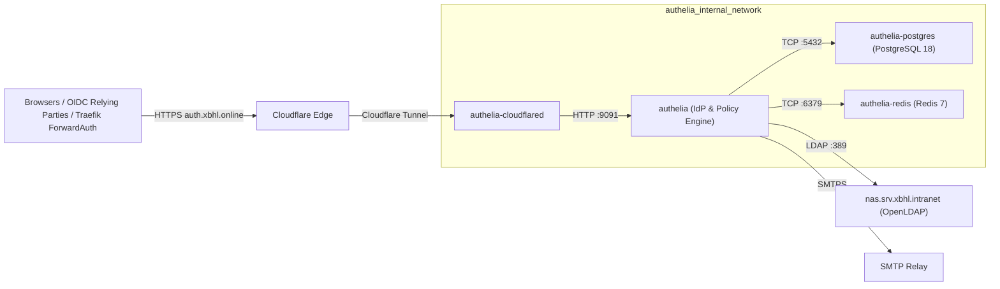

# Authelia

> Version: `4.39.28` | Images: `ghcr.io/authelia/authelia:4.39.28`, `docker.io/library/postgres:18.4`, `docker.io/library/redis:7.2-alpine`, `cloudflare/cloudflared:2026.7.3` | Upstream: https://github.com/authelia/authelia

Central OpenID Connect (OIDC) 1.0 Identity Provider, WebAuthn/passkey two-factor authentication portal, and forward-auth policy engine for `xbhl.online` and `intranet.xbhl.online` services.

## Overview

| Property | Value |
| :--- | :--- |
| **Domain** | `https://auth.xbhl.online` |
| **Node** | `nas.srv.xbhl.intranet` (QNAP NAS Docker Host) |
| **Ingress** | Cloudflare Tunnel (`authelia-cloudflared`, isolated from host ports and Traefik `proxy`) |
| **Authentication** | OpenLDAP on `nas.srv.xbhl.intranet` + WebAuthn/passkey 2FA (`two_factor` on `*.xbhl.online`) |
| **Ecosystem** | WUD SemVer tracking on `authelia`; Gatus health & container checks (`authelia` group) |

## Architecture & Key Decisions

- **Cloudflare Tunnel-Only Isolation**: Runs inside `authelia_internal_network` with zero published host ports and no attachment to the Traefik `proxy` network; `authelia-cloudflared` (`production` Compose profile, skipped in DinD CI) publishes `https://auth.xbhl.online` directly via Cloudflare Edge.
- **Directory, Session & Storage Backing**: Resolves users and groups (`"Domain Power Users"` maps to downstream admin roles) against OpenLDAP on `nas.srv.xbhl.intranet`, storing `xbhl.online` SSO sessions in Redis and persistent user, WebAuthn, and OIDC state in PostgreSQL.
- **Centralized OIDC 1.0 IdP & Traefik ForwardAuth**: Serves OIDC 1.0 relying parties and Traefik `forwardAuth` policies from Go-templated split configs (`src/authelia-config/`, `X_AUTHELIA_CONFIG_FILTERS=template`). Reference [Authelia OIDC Client Integrations](https://www.authelia.com/integration/openid-connect/clients/) for upstream app parameters and [`.agents/skills/add-oidc-client/SKILL.md`](./.agents/skills/add-oidc-client/SKILL.md) to onboard new clients.

### External Credentials

- `CLOUDFLARE_TUNNEL_TOKEN`: Cloudflare Zero Trust tunnel token decoded during CI build into `cloudflared` tunnel credentials.
- `OIDC_ISSUER_PRIVATE_KEY`: RSA PEM signing key stored as a GitLab **File** CI/CD variable to keep OIDC JWKS stable across deployments.

## Upgrades & Maintenance

- **Upstream & Wrapper Sources**: Review the [Authelia Configuration Migration Guide](https://www.authelia.com/configuration/prologue/migration/), [Storage Schema Migrations](https://www.authelia.com/configuration/storage/migrations/), and [OIDC Client Integrations](https://www.authelia.com/integration/openid-connect/clients/) for deprecated YAML keys or client policy updates across `src/authelia-config/`.
- **Version & Flavor Constraints**: `authelia` tracks stable `^\d+\.\d+\.\d+$$` releases (`wget` and `/bin/sh` required for healthchecks); `postgresql` (PostgreSQL 18), `redis`, and `cloudflared` (`production` profile) are pinned sidecars unmanaged by WUD.
- **Intentional Choices (Do Not Propose)**: Keep `authelia` isolated behind Cloudflare Tunnel without host ports or Traefik `proxy` attachment, retain OpenLDAP on `nas.srv.xbhl.intranet`, and preserve the upstream-mandated public/native ownCloud Infinite Scale (`ocis`) clients in `src/authelia-config/clients.yaml`.
- **Upgrade & CI Gotchas**: Update `test:authelia:validate-config` `image.name` in `.gitlab-ci.yml` in lockstep with `src/docker-compose.yml`, and preserve `X_AUTHELIA_CONFIG_FILTERS=template` plus the `.gitlab-ci.yml` `awk` single-line `\n`-escaping step that formats File variable `OIDC_ISSUER_PRIVATE_KEY` for Go template rendering.
